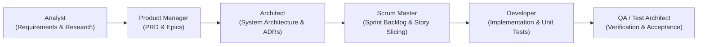

# BMAD Framework Synthesis: The READ Framework Codification

**Document Status:** Architectural Synthesis & Formal Framework Foundation  
**Framework Name:** **READ** (**R**esource-conscious, **E**vidence-driven **A**I **D**evelopment)  
**Target Tracks:** BMAD Framework vs. READ Framework  
**Authoritative Sources:** `files/explain_bmad_framework/main_00_212msgs.md`, `files/Methodology_Master-1/`  
**Date:** 2026-11-22  

---

## Conceptual Project Identity: READ Framework

> **READ**: **R**esource-conscious, **E**vidence-driven **A**I **D**evelopment
> 
> *"We are not building a consumer-grade framework to hide complexity behind a soft abstraction layer. We are open-sourcing the Architect's brain. The complexity is the product. The objective is to clone six years of battle-tested, low-resource operational rigor into a reproducible engineering protocol."*

### The Core Philosophy of READ
The name **READ** directly enshrines the Architect's primary engineering law:
- **Read the repo before touching code.** (Investigate before implementing).
- **Resource-conscious:** Runs in 1.2 GB RAM, 100% offline on mobile ARM/Termux, or for fractions of a cent on cloud VPS.
- **Evidence-driven:** No conversational trust; requires machine-verifiable exit codes, staged diff hashes, and bounded mutation testing.
- **AI-Directed:** Model routing across capability tiers ($C_0 \to C_3$) with a blinded verification pass and the Master Override.
- **Development-Focused:** Gated 4-stage lifecycle (`Define` $\to$ `Build` $\to$ `Verify` $\to$ `Handoff`).

---

## Philosophical Divergence: Why READ Rejects BMAD's Core Assumptions

### 1. Persona Theater vs. Deterministic Routing
- BMAD Assumption: Simulating anthropomorphic organizational hierarchies (Product Manager, Architect, Scrum Master, Developer, QA) via prompt-engineered roleplay induces specialized problem-solving and mirrors effective human engineering teams.
- READ Rejection: Persona roleplay is stochastic theatre that introduces prompt bloat, token burn, and hallucination drift. Prompting an LLM to "act as a QA Architect" does not confer actual verification rigor; it merely generates ungrounded conversational agreement and non-deterministic persona interference without mathematical guarantees.
- READ Axiom: Compute routing must be deterministic and tiered by task physics ($C_0 \to C_3$). Algorithmic and structural tasks are resolved via zero-token deterministic tools like the C0-AST resolver and tree-sitter symbol extractors; high-parameter models are invoked strictly for synthesis and guided by CAS state locks.

### 2. Narrative PRDs vs. Machine-Verifiable Contracts
- BMAD Assumption: Comprehensive, natural-language Product Requirement Documents (PRDs) and conversational user stories serve as the primary medium of architectural truth and intent transfer between agents.
- READ Rejection: Prose specifications are inherently ambiguous and non-executable. LLMs processing narrative PRDs suffer from semantic drift, arbitrary edge-case invention, and unverifiable claims of compliance, resulting in silent regressions and uncompilable code masked by confident conversational summaries.
- READ Axiom: System intent is defined by declarative, machine-verifiable contracts (`PROJECT.md`, `TASK.md`) containing explicit acceptance criteria, strict command exit codes, and immutable content hashes. State transitions are frozen via cryptographic SHA-256 contract digests enforced by mechanical CAS state locks.

### 3. Conversational QA vs. Cryptographic Evidence
- BMAD Assumption: Software quality is validated through an interactive dialogue between a developer agent and a QA agent reviewing transcripts, diff summaries, and conversational assertions.
- READ Rejection: Conversational QA operates entirely on trust, leading to sycophantic approval loops and false positives. An agent stating "tests pass cleanly" produces zero forensic auditability and frequently masks broken assertions, unexecuted test files, or tautological mocks.
- READ Axiom: Verification is strictly empirical, blinded, and cryptographically notarized. Changes are evaluated via the AROP 100% gate, which injects up to 10 targeted AST mutants into the staged diff; ANY surviving mutant causes an immediate commit abort. Verification receipts are sealed directly into an immutable Write-Ahead Log (`WAL.log`).

### 4. Unmetered Abundance vs. Computational Finitude
- BMAD Assumption: Software development can presume infinite context windows, unmetered multi-agent API calls, and boundless cloud execution environments without local memory or execution ceilings.
- READ Rejection: Assuming unmetered resources results in quadratic billing explosions, context window degradation, and process instability via runaway subprocesses and OOM kills. Massive prompt-prefilling degrades attention mechanism precision over critical code tokens.
- READ Axiom: Every execution must operate within strict, finite physical boundaries. Context is strictly filtered to necessary symbol closures via the C0-AST resolver, while child processes are constrained at the OS level using dynamic RLIMIT calibration set to a strict 30% available RAM ceiling and sub-second execution timeouts.

---

## Executive Summary

This document synthesizes the **BMAD (Breakthrough Method of Agile AI-Driven Development)** framework, analyzes how the framework was interpreted, adapted, and fundamentally redirected within the user's research trajectory, and articulates the resulting engineering design intent. 

While BMAD served as the initial intellectual catalyst for structuring AI-assisted software development into discrete roles and agile phases, the research documented in `main_00_212msgs.md` and consolidated in `Methodology_Master-1` establishes that directly cloning BMAD or superficially renaming its agent personas is an anti-pattern. Instead, the user's methodology redirects BMAD's persona-based agile workflow into an **evidence-driven, resource-constrained, mathematically bounded, model-agnostic engineering methodology** designed to democratize high-rigor software engineering across varied skill levels and constrained hardware.

---

## 1. Core BMAD Concepts

### 1.1 Genesis and Identity
BMAD was established as an open-source framework ([bmad-code-org/BMAD-METHOD](https://github.com/bmad-code-org/BMAD-METHOD)) designed to bring agile software engineering discipline to Large Language Model (LLM) interactions. Rather than utilizing an AI assistant as an unstructured single-agent code generator (which routinely suffers from context rot, hallucinations, architectural drift, and silent regression), BMAD structures development into specialized agent roles operating across defined project phases.

### 1.2 Specialized Agent Roles
BMAD distributes engineering responsibilities across discrete personas modeled after a classic cross-functional agile development squad:



- **Analyst:** Conducts problem discovery, domain research, competitive analysis, and feasibility assessments.
- **Product Manager (PM):** Translates research into formal Product Requirement Documents (PRDs), user stories, acceptance criteria, and priority backlogs.
- **System Architect:** Evaluates technical feasibility, creates component designs, selects technology stacks, documents Architecture Decision Records (ADRs), and defines interface contracts.
- **Scrum Master:** Manages sprint execution, slices epics into discrete actionable tasks, tracks progress, and coordinates task transitions.
- **Developer:** Consumes task instructions, operates within specified architectural boundaries, and writes source code and unit tests.
- **QA / Test Architect:** Audits implementations against PRD acceptance criteria, generates regression test suites, executes verification passes, and signs off on deliverables.

### 1.3 Documentation Quartet and Artifact Flow
BMAD structures agent communication around a disciplined document hierarchy:
1. **Product Requirements Document (PRD):** Functional/non-functional requirements, target personas, scope boundaries, and high-level milestones.
2. **System Architecture Document (SAD / ARCHITECTURE):** Module decomposition, data schemas, service interfaces, state models, and deployment topology.
3. **Sprint & Task Backlog (EPIC / TASKS / STORIES):** Atomic, bite-sized tasks with explicit completion definitions.
4. **Quality & Verification Reports (TEST_PLAN / AUDIT):** Test results, coverage metrics, defect reports, and release gates.

---

## 2. User's Encounter and Historical Precursors

The transcript in `files/explain_bmad_framework/main_00_212msgs.md` and historical records in `Methodology_Master-1/02_history/` show that BMAD was not an unfamiliar concept introduced de novo. The user had encountered and experimented with BMAD concepts across multiple earlier development epochs:

### 2.1 The VIREN and Fraol Agent CLI Precursors (Nov 2025)
- **The VIREN Concept:** In November 2025, the user studied BMAD and proposed an agile multi-agent framework named **VIREN**. In that historical iteration, the user envisioned an expansive system containing over **50 specialized domain agents**, complete with workflows, adapters, and multi-CLI orchestration.
- **Fraol Agent CLI (PRD dated 2025-11-13 / 2025-11-14):** A proposed orchestrator spanning installed CLI agents (`claude`, `gemini`, `kimi`, `qwen`) featuring skill registries, Gemini-based intent routing, local Ollama/Llama fallbacks, timestamped logs, and risk confirmations.
- **Historical Ambition vs. Reality:** As recorded in `02_history/claude/17_CONTRADICTIONS_AND_EVOLUTION.md` and `10_ADVISOR_JUDGMENT.md`, this early phase exhibited "novelty fixation" and "unbounded scope"—attempting to duplicate the entirety of BMAD's catalog while adding dozens of custom personas. Crucially, the evidence audit classified Fraol Agent CLI as `PROPOSED (never evidenced as built)`.

### 2.2 The Pivot Away from Persona Swarms
When re-engaging BMAD at the start of `main_00_212msgs.md` (Msg 1–2):
- **User:** *"You know bmad right... Good so I want to build my own but to help everyone and my own is all things you learn about me and my full ai workflow how I do thse 6 years of experience I just want to help people so what did you think"*
- **Assistant / Advisor Intervention:** 
  > *"I would not build a BMAD clone. Build your own AI-driven software engineering methodology. BMAD should be a reference, not the foundation of your identity... The objective is not to combine BMAD, GSD, RAF and dozens of other tools into one enormous framework. That would create unnecessary complexity. The objective is to identify the smallest set of principles and mechanisms that delivers measurable outcomes."* (`main_00_212msgs.md`, lines 54–180 & 513087).

This marked a permanent pivot: from an aspirational swarm of 50 anthropomorphic agents to a rigorous, grounded engineering methodology derived from 6 years of documented software development trials.

---

## 3. Systematic Adaptations of BMAD Principles

| Dimension | BMAD Baseline | The Master's Crucible (v0.7) | Design Rationale & Precursor Evidence |
| :--- | :--- | :--- | :--- |
| **Agent Paradigm** | Persona role-playing (Analyst, PM, Scrum Master, Dev, QA) | Model Capability Classes (C0–C3) & Master Override | VIREN failure: 50+ persona prompts hallucinated authority. Compute tiering routes compute based on task physics. Master retains override authority. |
| **Tool Execution** | LLM-driven reasoning for all operations | Deterministic First (C0-AST & Grep) | KURA lesson: Complex heuristic optimizers get beaten by simple deterministic algorithms. Zero tokens, 100% precision. |
| **Context Management** | Transcript passing / full document injection | C0-AST Transitive Closure Extraction | Hermes lesson: 277k token prefill caused context rot and quadratic billing. AST extracts only exact callers and definitions. |
| **Verification & Gatekeeping** | QA persona review based on claimed completion | Bounded Diff Mutation ($\le 10$ mutants) & AROP | Veloce Stage 4 lesson: Regex parsers accepted malformed logs. Mutation testing proves the test suite actually catches defects. |
| **Environment Parity** | Implicit cloud/workstation assumptions | Deterministic `.rafenv` Environment Lock | Alphabet lesson: Stale test fixtures and missing compiler configurations caused false passes across platforms. |
| **State Resilience** | In-memory session continuation | Atomic Swap (`STATE.json`) + WAL (`RECOVER`) | Veloce Termux lesson: Android lmkd kills background processes. Atomic swap and append-only WAL guarantee zero token loss on resume. |
| **Human Authority** | Human as passive prompt-submitter | Master's Override (HIL) with Hashed Rationale | The master craftsman's architectural intuition ("smell test") overrides mechanical gates, immutably recorded in the forensic chain. |

---

## 4. Architectural Design Intent

The design intent of the adapted methodology centers on four primary pillars:

```
                          ┌───────────────────────────────────────┐
                          │    HUMAN AGENCY & THE MASTER'S EYE    │
                          │   (Master's Override, Smell Test)     │
                          └──────────────────┬────────────────────┘
                                             │
               ┌─────────────────────────────┴─────────────────────────────┐
               ▼                                                           ▼
┌───────────────────────────────┐                         ┌───────────────────────────────┐
│     EVIDENCE-DRIVEN RIGOR     │                         │      RESOURCE DEMOCRATIZATION  │
│ - Bounded diff mutation tests │◄───────────────────────►│ - Low-resource Termux/mobile  │
│ - Machine-locked CAS states   │                         │ - Deterministic .rafenv parity│
│ - Crash-resilient WAL recovery│                         │ - Zero-cost offline survival  │
└───────────────────────────────┘                         └───────────────────────────────┘
               ▲                                                           ▲
               └─────────────────────────────┬─────────────────────────────┘
                                             │
                          ┌──────────────────┴────────────────────┐
                          │     PORTABLE, ADAPTABLE CONTRACTS     │
                          │     (Markdown/JSON, Runtime-Agnostic) │
                          └───────────────────────────────────────┘
```

---

## 5. Synthesis Summary

BMAD contributed the foundational idea of **structure, phase boundaries, and role separation** to replace unstructured prompting. However, the user's methodology refactors this foundation:
1. It replaces persona theatrics with **compute-calibrated capability routing**.
2. It replaces conversational trust with **asymmetric verification and forensic evidence**.
3. It replaces bloated context windows with **deterministic C0-AST dependency extraction**.
4. It elevates **crash-resilient offline viability, environment parity, and human master oversight** to first-class architectural constraints.
