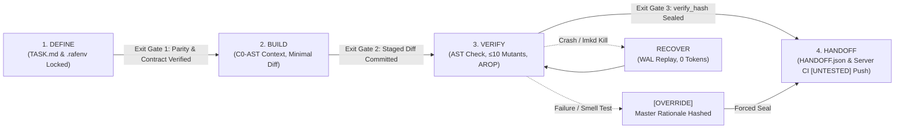

# The READ Framework: v0.7 Normative Specification
## **R**esource-conscious, **E**vidence-driven **A**I **D**evelopment

**Document Status:** Official Normative Specification v0.7 (Codified Master's Framework)  
**Framework Identity:** **READ** (Resource-conscious, Evidence-driven AI Development)  
**Axiomatic Foundations:** Compute-Calibration, Minimum Sufficient Context, Deterministic Routing  
**Authoritative Sources:** `files/Methodology_Master-1/`, `files/explain_bmad_framework/main_00_212msgs.md`  
**Date:** 2026-11-22  

---

## Executive Summary: The READ Framework

The **READ Framework** marks a deliberate paradigm shift. We are not designing a "consumer-grade framework" to hide complexity behind a soft abstraction layer. **We are open-sourcing the Architect's brain.** 

The name **READ** directly enshrines the Architect's foundational law:
- **R — Resource-Conscious:** Strictly bounded to a 1.2 GB RAM ceiling; executes 100% offline on Android Termux or cloud VPS; eliminates unmetered token burn.
- **E — Evidence-Driven:** Replaces conversational trust with machine-verifiable exit codes ($exit == 0$), cryptographic state-diff digests, and bounded mutation testing.
- **A — AI-Directed:** Pragmatic capability routing ($C_0 \to C_3$) incorporating DeepSeek-style modular provider seams, blinded verification gates, and the Master Override.
- **D — Development-Focused:** A disciplined 4-stage gated lifecycle (`Define` $\to$ `Build` $\to$ `Verify` $\to$ `Handoff`) designed to help any developer build reliable software.

### Key Architectural Upgrades in v0.7:
1. **The Master's Override (HIL - Human In The Loop):** Re-establishes the human architect as the ultimate authority. An operator can override any deterministic CAS lock or AROP verdict using an `[OVERRIDE]` message, provided an architectural `rationale` is immutably hashed into `WAL.log` and `EVIDENCE.json`.
2. **Master's Rationale Blocks:** Every Core Discipline now embeds the exact historical failure postmortem justifying its existence.
3. **The `.rafenv` Environment Parity Spec:** A mandatory Stage 1 artifact locking the exact versions of the $C_0$ toolchain and local model GGUF hash to eliminate environment drift.

---

## 1. The Four Core Disciplines & Master's Rationales

Every discipline is codified with the Architect's historical postmortem.

```
┌────────────────────────────────────────────────────────────────────────┐
│ 1. CONTRACT & INTENT                                                  │
│    - Binds problem, non-goals, risk tier (R0-R4), and testable criteria│
│    - Master's Rationale: VIREN & Fraol CLI Swarm Failure Postmortem   │
├────────────────────────────────────────────────────────────────────────┤
│ 2. C0 DETERMINISTIC CONTEXT RESOLUTION                                 │
│    - AST import tree extraction, zero-guess dependency closure         │
│    - Master's Rationale: Hermes 277k Token Burn & KURA Complexity Post │
├────────────────────────────────────────────────────────────────────────┤
│ 3. BOUNDED DIFF EXECUTION & CAS LOCKS                                  │
│    - Atomic staged diffs, CAS state locks, Termux 1.2GB memory floor   │
│    - Master's Rationale: Veloce Android lmkd & Gradle Crash Postmortem │
├────────────────────────────────────────────────────────────────────────┤
│ 4. FORENSIC ASYMMETRIC VERIFICATION & HANDOFF                          │
│    - &le;10 diff mutants, batched diff hash, sealed HANDOFF.json, HIL  │
│    - Master's Rationale: Veloce Stage 4 Fake Log & Alphabet Postmortem │
└────────────────────────────────────────────────────────────────────────┘
```

### 1.1 Core Discipline 1: Contract & Intent
- **Normative Rule:** No code may be written until `TASK.md` is frozen with explicit non-goals, a classified Risk Tier (R0–R4), and machine-verifiable acceptance predicates ($exit == 0$).
- > **Master's Rationale (The VIREN & Fraol CLI Postmortem):**  
  > *"In November 2025, we attempted to build VIREN and the Fraol Agent CLI around an unconstrained swarm of 50+ specialized agent personas. The project collapsed under its own weight. Without frozen task contracts, agents debated requirements in endless prompt loops, hallucinated capabilities, drifted from the core problem, and made unrequested architectural changes. We learned that anthropomorphic personas are toys; rigid, versioned task contracts are the only mechanism that prevents scope creep and context rot."*

### 1.2 Core Discipline 2: $C_0$ Deterministic Context Resolution
- **Normative Rule:** LLMs are strictly forbidden from guessing or retrieving their own context. Context retrieval is an unmetered, $0$-token compiler pass using Python `ast` or `tree-sitter` to extract the exact import tree and transitive symbol definitions.
- > **Master's Rationale (The Hermes & KURA Postmortem):**  
  > *"During the Hermes experiments, unmetered context injection resulted in a 277k-token prompt prefill (a 76 KB system prompt and 2.68 MB raw context), triggering massive billing, severe attention degradation, and prompt cache evictions. Simultaneously in KURA (the Rust MoE runtime), we proved that complex heuristic optimizers (KAEF) were routinely beaten by simple, deterministic algorithms while consuming zero memory overhead. We realized that using an LLM to guess its context is a rookie anti-pattern. Code structure is a deterministic graph; parse the AST directly."*

### 1.3 Core Discipline 3: Bounded Diff Execution & CAS State Locks
- **Normative Rule:** All implementation changes must be emitted as unified diffs touching only files within the contract scope. The working tree must remain clean. State transitions are governed by atomic Compare-And-Swap (CAS) revision locks.
- > **Master's Rationale (The Veloce Studio Postmortem):**  
  > *"Building Veloce Studio (a lightweight Linux terminal Android IDE on a 1.5 GiB RAM floor) taught us the brutal physics of mobile ARM execution. When an AI agent was permitted to perform unrestricted multi-file rewrites, memory spiked, Android's Low Memory Killer Daemon (lmkd) killed the process mid-write, leaving the Git repository corrupted and the Gradle daemon in an unrecoverable lock. Bounded staged diffs and POSIX atomic .tmp swaps are non-negotiable survival gear."*

### 1.4 Core Discipline 4: Forensic Asymmetric Verification & Handoff
- **Normative Rule:** Verification is asymmetric: generation uses local compute ($C_1$), but verification relies on deterministic syntax gates ($C_0$) and Bounded Diff-Targeted Mutation ($\le 10$ mutants). Mobile devices terminate at `Handoff`, emitting `HANDOFF.json` and deferring CI/CD [UNTESTED] to servers.
- > **Master's Rationale (The Veloce Stage 4 & Alphabet Postmortem):**  
  > *"In the Veloce Stage 4 audit, we discovered that naive regex log parsers accepted malformed test runs and duplicate success logs as green passes. In Alphabet, fixture reductions (reducing Fibonacci tests from 30 to 20) were used to silently mask performance regressions, and test denominators went stale (reporting 467 tests when 585 existed). Trusting an AI's conversational claim of 'tests passing' is fatal. You must execute bounded mutation testing against the diff to prove the test suite actually catches broken logic."*

---

## 2. The Master's Override Protocol (Human in the Loop)

### 2.1 The Architectural "Smell Test"
A rigid automated pipeline can become its own failure mode when a deterministic test oracle is flawed, an upstream dependency has an unresolvable bug, or an experienced engineer's architectural intuition identifies a superior path. The methodology codifies the **Master's Override** as a first-class operational primitive.

The Master's Override allows the human operator to force a state transition, bypass a failed AROP mutant gate, or modify an active contract without violating the forensic audit chain.

### 2.2 The Override Message Schema (`[OVERRIDE]`)
The override is invoked via the `OVERRIDE` message schema:

```
[OPERATOR] ──(OVERRIDE + Rationale)──► [ORCHESTRATOR] ──► [IMMUTABLE WAL LOG]
                                                                 │
                                                                 ├──► State Transition Forced
                                                                 └──► verify_hash Sealed with Override
```

### 2.3 The Master Override JSON Schema
```json
{
  "$schema": "http://json-schema.org/draft-07/schema#",
  "title": "MasterOverridePayload",
  "type": "object",
  "required": [
    "override_id",
    "task_id",
    "operator_id",
    "target_state",
    "rationale",
    "bypassed_gates",
    "timestamp"
  ],
  "properties": {
    "override_id": {
      "type": "string",
      "pattern": "^OVR-[0-9]{4}-[0-9]{2}-[0-9]{2}-[0-9]{3}$"
    },
    "task_id": {
      "type": "string"
    },
    "operator_id": {
      "type": "string",
      "description": "Identifier of the human operator or authorized engineering role"
    },
    "target_state": {
      "type": "string",
      "enum": ["executing", "verified", "handoff_complete", "blocked"]
    },
    "rationale": {
      "type": "string",
      "minLength": 30,
      "description": "Mandatory engineering justification explaining why the gate was overridden"
    },
    "bypassed_gates": {
      "type": "array",
      "items": {
        "type": "string",
        "enum": ["AST_SYNTAX_GATE", "MUTATION_TEST_GATE", "CAS_REVISION_LOCK", "BUDGET_CEILING"]
      }
    },
    "timestamp": {
      "type": "string",
      "format": "date-time"
    }
  }
}
```

### 2.4 Immutable Evidence Chain Binding
When an `[OVERRIDE]` is processed, the system appends a hashed and immutably logged tombstone directly into `.method/WAL.log`:
1. The orchestrator computes:
   $$\text{OverrideHash} = \text{"OVR-"} + \text{SHA256}(\text{Rationale} + \text{OperatorID} + \text{Timestamp})$$
2. The override event, operator identity, rationale, and generated hash are appended directly to `.method/WAL.log`.
3. In `EVIDENCE.json`, the verdict is recorded as `PASS_WITH_OVERRIDE`, binding the `OverrideHash` directly to the `verify_hash`. The forensic audit chain remains 100% transparent.
4. **Security Property**: Provides integrity and auditability via WAL chaining; does NOT provide non-repudiation.

### 2.5 Cryptographic Primitives for Master Override

The Master Override mechanism relies strictly on unkeyed cryptographic hashing and append-only hash-chained logging. The properties and boundaries of the implemented primitive are:

| Field | Specification |
| :--- | :--- |
| **Primitive Name** | SHA-256 (NIST FIPS 180-4) with Merkle-linked Write-Ahead Logging (`WAL.log`) |
| **Security Property Provided** | **Integrity & Tamper-Evidence** (via SHA-256 collision resistance and linear parent-hash chaining in the WAL). **Auditability** (via mandatory $\ge 30$-character justification). <br/>**Explicit Non-Property**: Does **NOT** provide non-repudiation. Because no asymmetric private key (e.g., Ed25519 / ECDSA) signs the override payload, any entity with local write access to the repository process space could fabricate an operator ID string. |
| **Key Management Approach** | **None (Unkeyed Primitive)**. The override protocol accepts an arbitrary string `operator_id` (e.g., username, role, or local user ID) and hashes it together with the rationale and UTC timestamp. No public/private key pairs, certificates, or keyrings are stored, loaded, or verified. |
| **Failure Mode if Misapplied** | **False Sense of Attribution (Repudiation Risk)**: If an organization relies on the Master Override for legal or regulatory non-repudiation, a rogue developer could claim an override was executed by another operator by providing a forged `operator_id`. In high-adversarial enterprise environments, non-repudiation requires external commit signing (`git commit -S` via GPG/SSH) or future migration to asymmetric Ed25519 override signing. |

---

## 3. The `.rafenv` Environment Parity Specification

### 3.1 Eliminating Environment Drift
A core lesson from six years of development across Android Termux, low-end laptops, and cloud servers is that **code is meaningless without its exact runtime substrate**. If an apprentice runs `ruff` 0.1.0 while the Architect built against 0.3.0, or uses a different quant of the local model, the deterministic gates drift.

The `.rafenv` file is a mandatory Stage 1 (`Define`) artifact stored in the project root. Stage 2 (`Build`) cannot execute until `.rafenv` is validated.

### 3.2 The `.rafenv` Specification
```toml
# .rafenv - Deterministic Environment Parity Lockfile
# Version: 1.0 (v0.7 Crucible Specification)

[target_platform]
os = "linux"
distribution = "termux-android"
architecture = "aarch64"
kernel_min = "5.10.0"
max_rss_floor_mb = 1200

[c0_toolchain]
python = "3.11.6"
ruff = "0.3.0"
tree_sitter = "0.21.3"
git = "2.42.0"
ast_parser = "c0_ast_v0.7"

[local_model_substrate]
model_family = "qwen2.5-coder-3b"
quantization = "q4_k_m"
engine = "llama.cpp-b3120"
model_sha256 = "e3b0c44298fc1c149afbf4c8996fb92427ae41e4649b934ca495991b7852b855"
context_window_limit = 4096
gpu_layers = 0  # Pure CPU ARM execution

[deterministic_rules]
enforce_cas_locks = true
max_diff_mutants = 10
allow_master_override = true
```

### 3.3 Parity Verification Algorithm (Stage 1 Exit Gate)
```python
def verify_environment_parity(rafenv_path: pathlib.Path) -> bool:
    """Executed before any Build stage begins. Halts on environment drift."""
    spec = toml.load(rafenv_path)
    
    # 1. Check Python version
    if sys.version.split()[0] != spec["c0_toolchain"]["python"]:
        raise EnvironmentDriftError(f"Python mismatch: {sys.version} != {spec['c0_toolchain']['python']}")
        
    # 2. Check local model binary integrity
    model_path = pathlib.Path("~/.models/qwen2.5-coder-3b-q4_k_m.gguf").expanduser()
    if not model_path.exists():
        raise EnvironmentDriftError("Local model binary missing from expected Termux path")
        
    actual_hash = hashlib.sha256(model_path.read_bytes()).hexdigest()
    if actual_hash != spec["local_model_substrate"]["model_sha256"]:
        raise EnvironmentDriftError(f"Model hash drift: {actual_hash} != {spec['local_model_substrate']['model_sha256']}")
        
    return True  # Parity confirmed; State transitions to executing
```

---

## 4. The Four-Stage Gated Lifecycle (v0.7)



### 4.1 Stage Sizing and Exit Gates

| Stage | Inputs | Mandatory Activities | Required Deliverable | Hard Exit Gate |
| :--- | :--- | :--- | :--- | :--- |
| **1. DEFINE** | User intent, existing repo state | 1. Identify real problem and non-goals in `TASK.md`.<br/>2. Assign Risk Tier (R0–R4).<br/>3. Verify environment parity against `.rafenv`. | `TASK.md` + `.rafenv` lock | Contract frozen, `.rafenv` validated. |
| **2. BUILD** | `TASK.md`, target source file | 1. Execute **$C_0$ AST Context Resolver** to extract import tree.<br/>2. Retrieve exact symbol definitions into context envelope.<br/>3. Generate atomic unified diff via local $C_1$ model. | Git staged diff (`git diff --staged`) | Clean working tree, changes isolated to task scope, state `executing`. |
| **3. VERIFY** | Staged diff, test commands | 1. Execute criterion test commands in target environment.<br/>2. Pass 1: Static syntax/type gate (`C0`).<br/>3. Pass 2: **Bounded Diff-Targeted Mutation ($\le 10$ mutants)**.<br/>4. Generate `verify_hash` (or invoke `[OVERRIDE]`). | `EVIDENCE.json` (`verify_hash` sealed) | All criteria `PASS` (or overridden with rationale), state `verified`. |
| **4. HANDOFF** | Verified diff, `verify_hash` | 1. Validate CAS state lock (`verify_hash` present).<br/>2. Generate `HANDOFF.json` sealed payload.<br/>3. Execute lightweight, retry-able Git push.<br/>4. Defer CI/CD [UNTESTED] to server-side receiver. | `HANDOFF.json` + Pushed Commit | State transition CAS validated, state `handoff_complete`. |

---

## 5. Structural Compare-And-Swap (CAS) State Locks with Override Support

### 5.1 Updated State Machine Lifecycle
```text
[idle] ──► [defined] ──► [executing] ──► [verified] ──► [handoff_complete]
                           │                 │
                           │                 ├──► [OVERRIDE] ──► [verified]
                           ▼                 │
                       [blocked] ◄───────────┘
```

The state machine requires a valid `verify_hash` for `handoff_complete`. If an override occurred, `verify_hash` contains:
$$\text{verify\_hash} = \text{SHA256}(\text{AROP\_Outputs} + \text{OverrideHash})$$
This mathematically locks the Master's Override into the immutable lifecycle history.

---

## 6. Conclusion: The Master's Artifact

The v0.7 specification codifies the complete cognitive and operational architecture of the Master Architect. It does not compromise on rigor: it runs on a 1.2 GiB Termux floor, resolves context through deterministic AST compilation, enforces atomic CAS state transitions, locks environment parity via `.rafenv`, and preserves ultimate human authority through the Master Override protocol.
