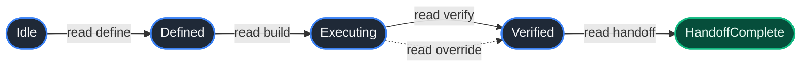
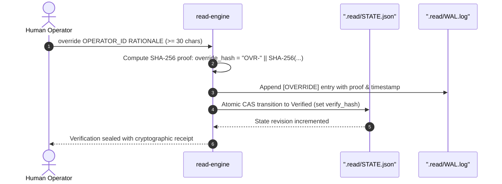

# READ: Resource-conscious, Evidence-driven AI Development

> **Stop burning tokens on conversation. Start building with cryptographic certainty.**  
> READ is an open-source verification framework that turns conversational AI coding assistants into rigorous, evidence-driven software engineers.

Supported natively on Linux (x86_64 and aarch64), macOS (Apple Silicon and Intel), and Windows (via WSL2 and universal Python MCP).

---

## The Vision: Why READ Exists

Modern AI coding assistants (like Claude, Cursor, Copilot, and Gemini) have transformed how we write software. They generate code at superhuman speeds, explain complex concepts fluently, and suggest creative solutions. But every developer and engineering team quickly runs into the same painful challenges:

1. **The Green Checkmark Illusion**: An AI tells you "I fixed the issue and all tests pass." But did the tests actually test the logic? Often, agents write superficial or tautological tests that pass without checking real boundary conditions, letting silent bugs slip straight into production.
2. **The Endless Token Burn**: Conversational tools dump entire source trees, boilerplate, and long chat histories into model context prompts over and over again. You burn through API budgets paying for tokens to re-read files that never changed.
3. **Session Amnesia and Fragile State**: When an agent session crashes, terminal times out, or the host reboots, conversational context vanishes. You have to re-prompt, re-spend tokens, and hope the agent remembers what it was doing.
4. **Lack of True Guardrails**: A conversational prompt cannot enforce operating system barriers. Models can accidentally alter out-of-scope files or declare tasks completed without authentic proof.

**READ changes this paradigm completely.**

Instead of relying on polite chat dialogue and unverified promises, READ brings deterministic systems mechanics and mathematical verification to AI development:
- **Zero-Token Local Context**: Extracts public function and class signatures locally in under 5 milliseconds for $0.00 token cost.
- **Strict 100% Mutation Gate (AROP)**: Automatically injects targeted bugs into modified lines to prove your test suite actually catches defects before allowing code to commit.
- **Zero-Command Git Experience**: No complex commands to memorize. READ integrates directly into your regular `git commit` workflow and declarative markdown files (inspired by the zero-command philosophy of BMAD).
- **Crash-Proof Write-Ahead Log (WAL)**: Every step is cryptographically recorded in an append-only log. If anything crashes, your state recovers in 15 milliseconds without spending a single token.

READ is divided into two decoupled execution layers:
1. **read-core**: A high-speed native Rust computational engine enforcing atomic state transitions, zero-token C0 AST context extraction, staged git diff hashing, append-only write-ahead logging (WAL), and asymmetric bounded mutation verification (AROP).
2. **read-daemon**: A robust Go host supervisor managing POSIX process supervision, WebSocket pseudo-terminal (PTY) multiplexing, dynamic agent socket discovery, real-time credential scrubbing, and 3-way storage synchronization across workstation, remote client, and VPS nodes.

---

## Installation

### 1. Universal MCP Server (Recommended for AI Assistants)
Install directly via Python without compiling native toolchains:
```bash
pip install git+https://github.com/fraol163/read.git
```
Or install with `pipx` for isolated global execution:
```bash
pipx install git+https://github.com/fraol163/read.git
```

#### One-Step Autonomous AI Agent Auto-Configuration
Run the interactive setup wizard to scan your host and automatically wire READ MCP tools and skills into your detected AI coding assistants:
```bash
read-mcp setup
```
Or scan without writing changes:
```bash
read-mcp detect
```

#### Manual MCP Client Configuration (Optional)
If configuring manually, add READ to your AI assistant configuration:

For **Claude Code** (`~/.claude.json` or run `claude mcp add read read-mcp`):
```json
{
  "mcpServers": {
    "read": {
      "command": "read-mcp",
      "args": []
    }
  }
}
```

For **Google Antigravity / Gemini CLI** (`~/.gemini/antigravity-cli/mcp/read.json`):
```json
{
  "command": "read-mcp",
  "args": []
}
```

For **Cursor** (`Settings -> Features -> MCP -> Add new MCP server`):
- Name: `read`
- Type: `command`
- Command: `read-mcp`

### 2. Standalone Shell Installer (Linux & macOS)
Install pre-compiled release binaries and configure your shell environment with a single command:
```bash
curl -fsSL https://raw.githubusercontent.com/fraol163/read/main/install.sh | bash
```
Or clone and run the installer locally:
```bash
git clone https://github.com/fraol163/read.git
cd read
./install.sh
```

### 3. Windows Installation
- **Recommended (WSL2)**: Open Windows Subsystem for Linux (Ubuntu, Debian, or Arch) and run the installer:
  ```bash
  wsl curl -fsSL https://raw.githubusercontent.com/fraol163/read/main/install.sh | bash
  ```
- **Native Python MCP**: Windows users can run `read-mcp` directly in Windows PowerShell or Command Prompt via:
  ```powershell
  pip install git+https://github.com/fraol163/read.git
  ```

### 4. Build from Source
Prerequisites: Rust 1.75+ (`cargo`) and Go 1.22+.
```bash
git clone https://github.com/fraol163/read.git
cd read
make install
```
Verify the installation:
```bash
read --version
read-mcp --check
```

---

## Table of Contents

1. [Installation](#installation)
2. [Core Technical Problem Space](#1-core-technical-problem-space)
3. [Dual-Engine Topology](#2-dual-engine-topology)
4. [The 4-Stage Gated Lifecycle](#3-the-4-stage-gated-lifecycle)
5. [Engine Subsystems (read-core)](#4-engine-subsystems-read-core)
   - [4.1 C0 Deterministic AST Context Resolver](#41-c0-deterministic-ast-context-resolver)
   - [4.2 Compare-And-Swap (CAS) State Engine](#42-compare-and-swap-cas-state-engine)
   - [4.3 Cryptographic Write-Ahead Log (WAL)](#43-cryptographic-write-ahead-log-wal)
   - [4.4 AROP Bounded Mutation Testing](#44-arop-bounded-mutation-testing)
   - [4.5 Master Override Audit Trail](#45-master-override-audit-trail)
6. [Daemon Subsystems (read-daemon)](#5-daemon-subsystems-read-daemon)
   - [5.1 Dynamic Agent and Socket Discovery](#51-dynamic-agent-and-socket-discovery)
   - [5.2 Process Supervision and PTY Multiplexing](#52-process-supervision-and-pty-multiplexing)
   - [5.3 3-Way Storage Engine](#53-3-way-storage-engine)
   - [5.4 Real-Time Credential Sanitization](#54-real-time-credential-sanitization)
7. [Command-Line Interface Reference](#6-command-line-interface-reference)
8. [HTTP & WebSocket Gateway API Reference](#7-http--websocket-gateway-api-reference)
9. [Documentation Suite](#8-documentation-suite)
10. [Verified Working Examples](#9-verified-working-examples)
11. [Automated Verification and Chaos Suites](#10-automated-verification-and-chaos-suites)
12. [Known System Limitations and Platform Support](#11-known-system-limitations-and-platform-support)
13. [Learning READ: Adversarial Induction Suite](#12-learning-read-adversarial-induction-suite)
14. [Short Assembly Micro-DSL and Machine-Readable YAML](#13-short-assembly-micro-dsl-and-machine-readable-yaml)
15. [Model Context Protocol (MCP) Server Integration](#14-model-context-protocol-mcp-server-integration)
16. [Empirical Real-World Benchmark: Alphabet Meta-Compiler](#15-empirical-real-world-benchmark-alphabet-meta-compiler)

---

## 1. Core Technical Problem Space

Conversational AI programming tools (such as raw chat interfaces, unconstrained agent loops, and prompt-engineered frameworks) suffer from four fundamental failure modes:

1. **Token Bloat and Cost Runaway**: Re-sending entire source trees, multi-page persona prompts, and verbose conversational histories consumes tens of thousands of tokens per iteration without guarantees of semantic accuracy.
2. **Silent Regressions and Tautological Tests**: Agents frequently report successful code generation when tests pass, yet the tests often assert nothing meaningful or fail to guard critical edge cases.
3. **Unenforced Lifecycle Invariants**: Without operating-system and filesystem barriers, an agent can declare a task finished despite introducing syntax errors, missing dependencies, or altering out-of-scope files.
4. **Process Amnesia**: When an execution environment crashes, runs out of memory (OOM), or experiences an interrupted session, conversational tools lose transient context, requiring a full re-spend of tokens to reconstruct working state.

READ eliminates these failure modes through mechanical systems enforcement rather than prompt engineering.

---

## 2. Dual-Engine Topology

```mermaid
flowchart TD
    subgraph Host["Host Systems (PC / VPS / CI Runner)"]
        subgraph Agents["Discovered AI Agents & Harnesses"]
            DSH["DeepSeek Harness (dsh)"]
            Claude["Claude Code CLI (claude)"]
            Aider["Aider (aider)"]
        end
        subgraph Sockets["Dynamic Socket & Engine Discovery"]
            Ollama["Ollama (:11434)"]
            Llama["llama.cpp (:8080)"]
            VLLM["vLLM (:8000)"]
        end
        subgraph Daemon["read-daemon (Go 1.22+)"]
            D1["Process Supervision & Output Multiplexing"]
            D2["Bidirectional Remote Terminal Streaming (PTY)"]
            D3["3-Way Storage Engine (pc_only, phone_only, both_sync)"]
            D4["Real-Time Secret Redaction (sk-ant, sk-proj, Bearer, gh tokens)"]
            D5["Workspace File Sandbox & Hash Verification"]
        end
        subgraph Core["read-core (Rust 1.75+)"]
            C1["C0 Deterministic AST Context Resolver ($0.00 cost, <5ms)"]
            C2["Compare-And-Swap State Engine (.read/STATE.json)"]
            C3["Append-Only Write-Ahead Log (.read/WAL.log, SHA-256 chaining)"]
            C4["Asymmetric Bounded Mutation Verifier (AROP, <=10 mutants)"]
            C5["Staged Diff Hasher (SHA-256 over git diff --staged)"]
            C6["Master Override Audit Trail ([OVERRIDE] with SHA-256 proof)"]
            C7["Zero-Token Crash Recovery System (7.5ms to 16.5ms)"]
        end
        Agents --> Daemon
        Sockets --> Daemon
        Daemon --> Core
    end
```



---

## 3. The 4-Stage Gated Lifecycle

All software modifications within READ proceed through a strictly gated, 4-stage mechanical lifecycle:



1. **Define Stage**:
   - Freezes the task contract (task ID, invariants, target files, base commit).
   - Computes SHA-256 contract digest and records it in `.read/STATE.json`.
   - Appends `DEFINE` event to `.read/WAL.log`.
2. **Build Stage**:
   - Acquires CAS worker lease.
   - Extracts C0 AST public interface context ($0.00 token cost).
   - Transitions state to `Executing`.
3. **Verify Stage**:
   - Stages modified code in Git worktree (`git add`).
   - Computes staged diff hash (`git diff --staged` streamed into SHA-256).
   - Runs AROP bounded mutation test suite.
   - Seals `verify_hash` into state and logs `VERIFIED` event in WAL.
   - Alternatively, records an audited human `MASTER_OVERRIDE` with rationale proof.
4. **Handoff Stage**:
   - Mechanically verifies that status is `Verified` and `verify_hash` is non-null.
   - Validates that `verify_hash` matches an authentic WAL cryptographic entry.
   - Checks staged diff stability: blocks handoff if code drifted since verification.
   - Transitions to `HandoffComplete` (verified in [01_test_e2e.log](evidence/logs/01_test_e2e.log)).

Detailed documentation: [LIFECYCLE.md](docs/LIFECYCLE.md).

---

## 4. Engine Subsystems (read-core)

### 4.1 C0 Deterministic AST Context Resolver
Instead of passing full source trees to LLMs:
- Traverses import declarations up to a configurable depth (default: 3).
- Extracts public function and class signatures, stripping function bodies and private implementation details.
- Supports Python, Rust, Go, TypeScript/JavaScript. Java, .NET, C++, and Ruby are experimental.
- Finishes in under 5 milliseconds on host CPU with zero external API calls.

### 4.2 Compare-And-Swap (CAS) State Engine
State is maintained in `.read/STATE.json` under atomic POSIX flock semantics:
- Revision Tracking: Every state transition increments `state_revision`.
- Atomic writes: Uses `.tmp` file creation followed by `fsync` and atomic `rename(2)`.
- Concurrent collision prevention: Worker leases expire automatically after duration unless renewed.

### 4.3 Cryptographic Write-Ahead Log (WAL)
Every mutation is written to `.read/WAL.log` before updating state:
```
<timestamp> | prev_hash=<64 hex> | <EVENT_TYPE> | <payload> | entry_hash=<64 hex>
```
- Each entry hashes the timestamp, previous hash, event type, and payload.
- In the event of an unexpected termination or process kill, `read-engine recover` verifies the log and restores state in 7.5 to 16.5 milliseconds without spending any LLM tokens.
- Automatically compacts with a `CHECKPOINT` entry when exceeding 10,000 entries or 5 MB.

### 4.4 AROP Bounded Mutation Testing
Standard mutation testing takes dozens of minutes across a codebase. AROP (Asymmetric Bounded Mutation Testing) enforces strict execution bounds:
- Restricts mutations strictly to modified lines in `git diff --staged`.
- Bounds mutant population to a maximum of 10 targeted alterations ($M \le 10$).
- Multi-language support: Python, Rust, Go, TypeScript/JavaScript are supported. Java, .NET, C++, and Ruby are experimental.
- Targeted AST mutation operators:
  - TypeScript / JavaScript: `INVERT_EQUALITY` (`===` <-> `!==`), `RETURN_UNDEFINED` (`return undefined`), `BOUNDARY_SHIFT`, `REMOVE_OPTIONAL_CHAIN` (`?.` -> `.`).
  - Java: `INVERT_EQUALITY` (`==` <-> `!=`, `.equals()` <-> `!.equals()`), `RETURN_NULL` (`return null`), `BOUNDARY_SHIFT`, `REMOVE_NULL_CHECK` (`if (x != null)` -> `if (true)`).
  - C# / .NET: `INVERT_EQUALITY` (`==` <-> `!=`, `.Equals()` <-> `!.Equals()`), `RETURN_DEFAULT` (`return default`), `BOUNDARY_SHIFT`, `REMOVE_NULL_CONDITIONAL` (`?.` -> `.`).
  - C++: `INVERT_EQUALITY` (`==` <-> `!=`, `<` <-> `<=`, `>` <-> `>=`), `RETURN_DEFAULT` (`return x` <-> `return {}` / `return nullptr` / `return 0`), `BOUNDARY_SHIFT` (`n` <-> `n+1`/`n-1`, `++` <-> `--`), `REMOVE_NULLPTR_CHECK` (`if (ptr != nullptr)` -> `if (true)`).
  - Ruby: `REMOVE_SAFE_NAVIGATION` (`x&.y` <-> `x.y`), `INVERT_EQUALITY` (`==` <-> `!=`, `===` <-> `!==`, `.eql?` <-> `!.eql?`), `RETURN_NIL` (`return x` <-> `return nil`), `BOUNDARY_SHIFT` (`n` <-> `n+1`/`n-1`, `<` <-> `<=`, `>` <-> `>=`).
- Universal test harness auto-detection:
  - Node.js / TS: `jest`, `vitest`, `mocha`, `node:test` from `package.json`.
  - Java: JUnit 4, JUnit 5, TestNG from `pom.xml` / `build.gradle` (Surefire/Failsafe XML parsing).
  - C# / .NET: xUnit, NUnit, MSTest from `*.csproj` (TRX XML parsing).
  - C++: Google Test, Catch2, CTest from `CMakeLists.txt` / `Makefile` (JUnit XML / Catch2 XML parsing).
  - Ruby: RSpec, Minitest from `Gemfile` / `Gemfile.lock` (RSpec JSON / Minitest TAP parsing).
- Enforces a 4.5-second execution timeout ceiling ($T \le 4500\text{ms}$).
- Verification requires a strictly 100% kill score ($S = 0$ surviving mutants, where any survivor immediately aborts commit).

### 4.5 Master Override Audit Trail
When legitimate changes produce surviving mutants or emergency fixes must bypass tests:
- An operator applies `read-engine override <OPERATOR> <RATIONALE>`.
- Rationale must be at least 30 characters.
- Generates cryptographic proof:
  ```text
  override_hash = "OVR-" || SHA-256(rationale || operator || timestamp)
  ```
  $$\mathrm{override}_{\mathrm{hash}} = \text{"OVR-"} \parallel \mathrm{SHA256}(\text{rationale} \parallel \text{operator} \parallel \text{timestamp})$$
- Seals state into `Verified` with full auditable trail in `WAL.log`.



---

## 5. Daemon Subsystems (read-daemon)

### 5.1 Dynamic Agent and Socket Discovery
The Go daemon scans host environments without hardcoded tool paths:
- Inspects `PATH`, `mise`, `npm`, `cargo`, and `pip` binaries (`dsh`, `claude`, `aider`, `interpreter`, `goose`, `cursor`, `gemini`).
- Probes local inference servers via 200ms socket timeouts: Ollama (`11434`), llama.cpp (`8080`), and vLLM (`8000`).
- Loads custom harness definitions from `.read/harnesses.json` or `~/.config/read/harnesses.json`.

### 5.2 Process Supervision and PTY Multiplexing
- Exposes `/ws/pty`, backed by `creack/pty`, for full interactive terminal streaming.
- Supports ANSI escape sequences, window resize events (`SIGWINCH`), and interrupt forwarding (`Ctrl+C`).
- Enforces process group isolation (`Setpgid: true`).
- Executes two-stage process cleanup on termination (`KillProcessTree`): `SIGTERM` -> 50ms wait -> `SIGKILL` -> `/proc` orphan sweep.

### 5.3 Multi-Node Storage Engine
Synchronizes workspace files across operational node roles:
- `pc_only`: Files kept exclusively on the developer workstation (e.g. build directories, local caches).
- `node_only`: Ephemeral artifacts for local inspection excluded from repository history.
- `both_sync`: Fully synchronized files tracked by hierarchical Merkle tree digests.

### 5.4 Real-Time Credential Sanitization
All daemon outputs, WebSocket terminal streams, and CLI arguments pass through 10 regular expression filters masking sensitive keys with `***REDACTED***`:
- Anthropic keys (`sk-ant-...`)
- OpenAI keys (`sk-proj-...`, `sk-...`)
- DeepSeek keys (`sk-[a-f0-9]{32,}`)
- GitHub Personal Access Tokens (`ghp-...`, `gho-...`)
- HTTP Bearer tokens (`Authorization: Bearer ...`)

---

## 6. Command-Line Interface Reference

### Native Core CLI (`read-engine` or `read`)

```bash
# Initialize state directory and WAL
read init

# View current CAS state machine status
read status

# Freeze task contract into defined state
read define <TASK_ID> <CONTRACT_HASH> <BASE_COMMIT>

# Transition state to executing (Build stage)
read build

# Deterministically extract public AST signatures ($0.00 cost)
read ast-context <TARGET_FILE>

# Compute SHA-256 digest of git diff --staged (<0.1ms)
read diff-hash

# Generate targeted diff mutants (<4.5s)
read mutate --staged

# Record verification output and seal verify_hash
read verify <DIFF_HASH> "<VERIFY_LOG>"

# Apply Master Override with human operator rationale
read override "<OPERATOR>" "<RATIONALE (min 30 chars)>"

# Execute CAS-gated handoff to handoff_complete (verified in evidence/logs/01_test_e2e.log)
read handoff

# Replay WAL and restore state after crash (0 tokens re-spent)
read recover
```

### Autonomous Pipeline & Host Discovery CLI (`read`)

```bash
# Discover and inspect all AI agent harnesses installed on the host (sub-150ms)
read scan

# Output discovered harnesses as structured JSON
read scan -json

# Execute autonomous 5-stage agent pipeline with verification gate
read run "Implement token verification logic"

# Execute autonomous pipeline targeting a specific agent harness
read run --harness=codex "Implement password hash verification"
```

### Daemon CLI (`read-daemon` or `read daemon`)

```bash
# Launch daemon on default port 8089
read daemon

# Launch daemon with custom port and workspace
read daemon --port=9000 --workspace=/path/to/repo --engine-bin=/path/to/read-engine
```

---

## 7. HTTP & WebSocket Gateway API Reference

When `read-daemon` is running, it exposes the following endpoints:

| Method | Endpoint | Description |
| :--- | :--- | :--- |
| `GET` | `/ws/pty` | WebSocket endpoint for interactive PTY terminal streaming. |
| `GET` | `/api/v1/status` | Returns system status, workspace root, harness count, and storage policy. |
| `GET` | `/api/v1/harnesses` | Returns list of all discovered and configured AI agent harnesses. |
| `POST`| `/api/v1/harnesses/toggle` | Enables or disables a specific harness. |
| `POST`| `/api/v1/harnesses/exec` | Spawns a harness within a dedicated isolated process group. |
| `POST`| `/api/v1/harnesses/stop` | Terminates a running harness and kills all child processes in the tree. |
| `GET` | `/api/v1/state` | Returns the current `.read/STATE.json` object. |
| `POST`| `/api/v1/state/override` | Submits a Master Override with rationale and operator ID (hashed tombstone in WAL). |
| `POST`| `/api/v1/task/command` | Proxies lifecycle commands (`define`, `build`, `verify`, `handoff`). |
| `GET` | `/api/v1/fs/list` | Lists files within the workspace root with SHA-256 hashes. |
| `GET` | `/api/v1/fs/read` | Safely reads a file within the workspace sandbox. |
| `POST`| `/api/v1/fs/write` | Safely writes a file within the workspace sandbox. |
| `GET` | `/api/v1/sync/manifest` | Generates a hierarchical Merkle manifest for delta synchronization. |
| `POST`| `/api/v1/sync/policy` | Sets the storage policy (`pc_only`, `phone_only`, `both_sync`) for paths. |

---

## 8. Documentation Suite

- [VISION.md](docs/VISION.md): Philosophical foundations and four core contrasts with BMAD.
- [SPECIFICATION.md](docs/SPECIFICATION.md): Normative RFC 2119 operational specification and enforcing test mappings.
- [EVIDENCE.md](evidence/EVIDENCE.md): Empirical test logs, benchmark measurements, and exit codes.
- [CLAIM_AUDIT.md](evidence/CLAIM_AUDIT.md): Detailed verification status of all technical claims.
- [ARCHITECTURE_REVIEW.md](docs/ARCHITECTURE_REVIEW.md): Independent systems review and trade-off analysis.
- [THREAT_MODEL.md](docs/THREAT_MODEL.md): Security boundaries, token auth, reverse proxy risks, and Git hook bypass mitigations.
- [GAPS.md](docs/GAPS.md): Known limitations, contract authoring overhead, and roadmap.
- [TUTORIAL.md](docs/TUTORIAL.md): Ten-minute student quickstart guide.
- [ARCHITECTURE.md](docs/ARCHITECTURE.md): Systems architecture, CAS state engine, append-only WAL, and PTY multiplexing.
- [LIFECYCLE.md](docs/LIFECYCLE.md): Gated lifecycle stages, contract hashing, and AROP mutation testing.
- [HARNESS_INTEGRATION.md](docs/HARNESS_INTEGRATION.md): Integration guide for agent CLIs and local inference servers.
- [CONFIGURATION.md](docs/CONFIGURATION.md): Configuration files and storage policy reference.
- [SECURITY_MODEL.md](docs/SECURITY_MODEL.md): Process isolation and credential scrubbing architecture.

---

## 9. Test Fixtures and Reference Implementations

Test fixtures and working reference implementations with test suites and lifecycle automation scripts are located in `examples/`:

- [Python Ingress Rate Limiter Service](examples/python_service/): Python service with pytest, demonstrating `read init`, `read define`, `read build`, `read verify`, `read handoff`.
  Run demo: `bash examples/python_service/run_demo.sh`
- [Rust Bounded Ring Buffer Crate](examples/rust_crate/): Rust library crate with cargo tests.
  Run demo: `bash examples/rust_crate/run_demo.sh`
- [Go Concurrent In-Memory Cache Module](examples/go_module/): Go package with TTL expiration, goroutine safety, and standard go tests.
  Run demo: `bash examples/go_module/run_demo.sh`
- [TypeScript Authorization Service](examples/typescript_service/): TypeScript microservice with Express and Jest, verifying RBAC permissions, optional chaining, and token validation under strict 100% mutation testing.
  Run demo: `bash examples/typescript_service/run_demo.sh`
- [Java Order Validation Service](examples/java_service/): Spring Boot and JUnit 5 microservice verifying role validation, null checks, and boundary logic under strict 100% mutation testing.
  Run demo: `bash examples/java_service/run_demo.sh`
- [C# Token Validation Service](examples/csharp_service/): ASP.NET Core and xUnit microservice verifying null conditionals (`?.`), `.Equals()` checks, and default returns under strict 100% mutation testing.
  Run demo: `bash examples/csharp_service/run_demo.sh`
- [C++ Buffer Pool Service](examples/cpp_service/): C++17 memory pool with CMake and Google Test, verifying pointer null checks, capacity boundaries, and return values under strict 100% mutation testing.
  Run demo: `bash examples/cpp_service/run_demo.sh`
- [Ruby Authentication Service](examples/ruby_service/): Ruby service with RSpec format verification, asserting safe navigation (`&.`), case equality (`===`), strict string equality (`eql?`), and TTL boundaries under strict 100% mutation testing.
  Run demo: `bash examples/ruby_service/run_demo.sh`

---

## 10. Automated Verification and Chaos Suites

The repository contains automated verification suites:

```bash
# 1. Native Rust Engine Verification (9 checks)
bash tests/test_e2e.sh

# 2. Host Daemon and Integration Verification (9 checks)
bash tests/test_full_system.sh

# 3. Chaos and Resiliency Suite (CAS collision, tamper resistance, recovery)
bash tests/test_chaos.sh
```

---

## 11. Known System Limitations and Platform Support

1. Platform Compatibility:
   - **Linux (x86_64 and aarch64)**: Tier-1 first-class native support with cgroups v2, RLIMIT process sandboxing, atomic POSIX locking, and PTY streaming.
   - **macOS (Apple Silicon and Intel)**: Supported via native POSIX runtime (flock file locking, POSIX PTY, BSD setrlimit).
   - **Windows**: Supported via WSL2 (recommended for full daemon process tree supervision and PTY multiplexing) and native Python MCP (`read-mcp`).
2. Virtual Memory Constraints (`RLIMIT_AS`): Setting `RLIMIT_AS` to 30% of RAM breaks 64-bit Java (JVM) and .NET CoreCLR runtimes on machines with under 6 GB memory. Use cgroups v2 instead of virtual memory limits for managed runtimes.
3. Mutation Truncation on Large Diffs: The AROP mutation engine accepts the first 10 mutants sequentially. Modified lines appearing later in a diff receive no mutation testing.
4. Reverse Proxy Header Spoofing: Trusting `X-Forwarded-For` allows external clients to spoof loopback status unless the reverse proxy strips client headers.
5. Client-Side Git Hook Bypass: Developers can bypass client hooks with `git commit --no-verify`. Deployments must enforce verification gates on server CI [UNTESTED] (`.github/workflows/read-gate.yml`), which serves as the authoritative enforcement point.

---

## 12. Learning READ: Adversarial Induction Suite

Adopters learn framework mechanics through adversarial failure simulation under the `read learn` command suite:

```bash
# Initialize isolated induction workspace under .read-learn/
read learn init

# Load specific induction scenario (1, 2, or 3)
read learn scenario <1|2|3>

# Run automated adversarial diagnosis on current scenario
read learn diagnose

# Inspect onboarding progress and mastery score in STATE.json
read learn progress
```

### The Three Adversarial Failure Scenarios

1. **Scenario 01: Brittle Test Trap (AROP 100% Mutation Gate Enforcement)**
   - The Trap: Code is paired with an apparently passing unit test suite that yields only an 80% mutation kill score (2 mutants survive boundary checks).
   - The Failure: Commit is blocked mechanically. Developer must strengthen assertions until 100% of mutants are killed.
   - Forensic Note: Test suites that merely run without asserting boundary behavior are an illusion. The AROP gate demands strictly 100% mutation kill score. If a mutant survives, the tests failed to verify the boundary.

2. **Scenario 02: Context Hallucination Burn (C0-AST Resolution vs Context Bloat)**
   - The Trap: Sprawling 12,000-token legacy service with bloated metadata.
   - The Contrast: In conversational systems, dumping full files triggers quadratic prefill costs and token bleed. In READ, the C0-AST context resolver deterministically extracts exact dependency closures in under 3ms for $0.00.
   - Forensic Note: Never spend tokens on code structure that deterministic AST analysis resolves locally.

3. **Scenario 03: CAS Race Condition (Atomic Locks and WAL Crash Recovery)**
   - The Trap: Simulated mid-build process crash leaves in-memory state desynchronized and CAS lease expired.
   - The Recovery: The developer triggers `read recover` to replay verified Write-Ahead Log entries, restoring state revision without re-executing agents or spending any tokens.
   - Forensic Note: Compare-And-Swap (CAS) state locks prevent concurrent corruption, while the cryptographic Write-Ahead Log (WAL) recovers state deterministically.

---

## 13. Short Assembly Micro-DSL and Machine-Readable YAML

To minimize token consumption during automated agent loops, READ provides a low-overhead bytecode-style Micro-DSL interpreter (`read asm`) and structured YAML status reporting (`read status --yaml`).

### Short Assembly Micro-DSL (`read asm`)
Instead of issuing verbose multi-token shell commands, an AI agent or harness can sequence atomic lifecycle transitions in a single compact instruction stream:

```bash
# Example: Initialize, define contract, start build, and inspect status
read asm "INIT | DEF TASK-001 <contract_hash> <base_commit> | BUILD | STATUS"
```

Supported opcodes:
- `INIT`: Initialize state engine and .read/ directory structure
- `DEF <id> <contract_hash> <base_commit>`: Freeze task contract into defined state
- `BUILD`: Transition lifecycle state to executing
- `AST_SIG <file>`: Extract deterministic symbol signatures without loading full file
- `MUT_GEN <diff>`: Generate targeted AST diff mutants
- `SCORE_CHECK <killed> <total>`: Enforce strict 100% mutation kill gate
- `SEAL <diff_hash> <log>`: Record verification and seal state
- `HANDOFF`: Execute Compare-And-Swap handoff transition
- `RECOVER`: Perform zero-token crash recovery from WAL.log
- `STATUS`: Output state machine status

### Structured YAML Status Reporting
For agents and pipelines requiring machine-readable output without regex parsing:

```bash
read status --yaml
```

Output:
```yaml
state_revision: 3
status: Executing
active_task: TASK-001
contract_hash: a1b2c3d4e5f6...
base_commit: a3e6770
staged_diff_hash: ~
verify_hash: ~
cas_lock:
  locked_by: system
  expected_revision: 3
  lease_expires: 2026-11-25T12:00:00Z
```

Built-in HTML reports with self-verifying SHA-256 digests can also be generated:
```bash
read report --html evidence/reports/report_latest.html
```

---

## 14. Model Context Protocol (MCP) Server Integration

READ provides a production Model Context Protocol (MCP) server (`read-mcp`) communicating over JSON-RPC stdio. This enables AI assistants (including Google Antigravity, Claude Code, and cursor) to invoke all framework operations directly as native tools.

### Available MCP Tools (21 Tools)
1. `read_status`: Inspect CAS state machine status.
2. `read_status_yaml`: Inspect CAS state in structured YAML format.
3. `read_init`: Initialize .read/ state and genesis WAL.
4. `read_define`: Freeze task contract into defined state.
5. `read_build`: Transition state to executing (Build stage).
6. `read_verify`: Record AROP verification and seal verify_hash.
7. `read_handoff`: CAS-gated transition to handoff_complete.
8. `read_recover`: Zero-token crash recovery from WAL.log.
9. `read_override`: Apply Master Override with hashed rationale.
10. `read_diff_hash`: Compute SHA-256 of git diff --staged (<0.1ms).
11. `read_ast_context`: Deterministically extract C0 AST context ($0.00).
12. `read_mutate`: Generate targeted diff mutants (<4.5s).
13. `read_eval_mutation_score`: Evaluate mutation score against strictly 100% gate.
14. `read_anchor_wal`: Cryptographically anchor WAL hash to git commit.
15. `read_verify_wal_anchor`: Verify git commit matches WAL anchor hash.
16. `read_learn`: Execute adversarial induction onboarding scenarios.
17. `read_config`: Display resolved configuration.
18. `read_scan`: Discover and inspect host AI harnesses.
19. `read_asm`: Execute Short Assembly Micro-DSL opcodes.
20. `read_run`: Execute unified autonomous agent pipeline.
21. `read_report_html`: Generate sealed HTML verification reports with SHA-256 digest.

---

## 15. Empirical Real-World Benchmark: Alphabet Meta-Compiler

To evaluate defect-detection capability outside synthetic tests, READ was benchmarked against the real-world open-source C++17 meta-compiler repository [fraol163/alphabet](https://github.com/fraol163/alphabet).

### Defect Scenario
In `src/type_system.cpp`, the method `TypeManager::is_compatible` evaluates type hierarchy compatibility:
```cpp
if (source_type <= I64 && target_type <= I64) {
    return (source_type <= target_type)
}
```
A boundary mutant was injected at line 60: `source_type <= target_type` changed to `source_type < target_type` (`BOUNDARY_SHIFT`).

### 3-Arm Empirical Evaluation Results

| Metric | Arm 1: Plain ctest | Arm 2: BMAD Conversational Review | Arm 3: READ Framework |
| :--- | :--- | :--- | :--- |
| **Pass/Fail Verdict** | PASSED (Exit Code: 0) | APPROVED ("LGTM") | BLOCKED (Exit Code: 1) |
| **Defect Detected** | NO (Silent survival) | NO (Conversational approval) | YES (BOUNDARY_SHIFT caught) |
| **Verification Basis** | Test runner exit code | Prose dialogue + Exit code | Cryptographic AST mutation gate |
| **Model Token Spend** | 0 tokens | ~2,500 prompt tokens | 0 tokens (Deterministic C0 AST) |
| **Audit Artifact** | Ephemeral console log | Ephemeral transcript | Immutable WAL cryptographic receipt |

Detailed benchmark log and forensic notes: [REAL_WORLD_BENCHMARK.md](evidence/REAL_WORLD_BENCHMARK.md).
